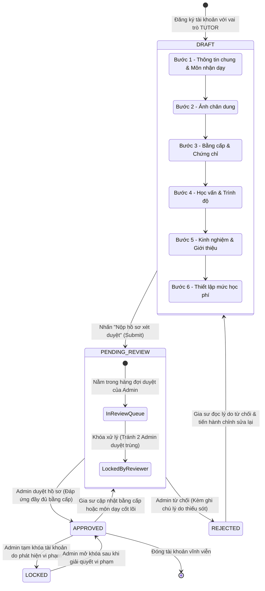
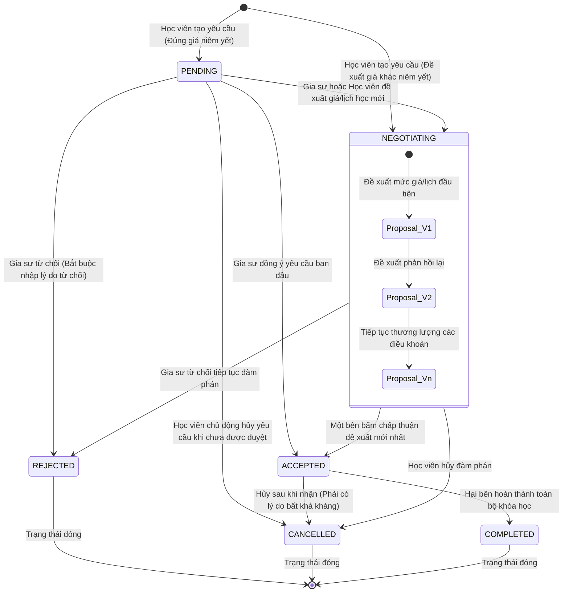
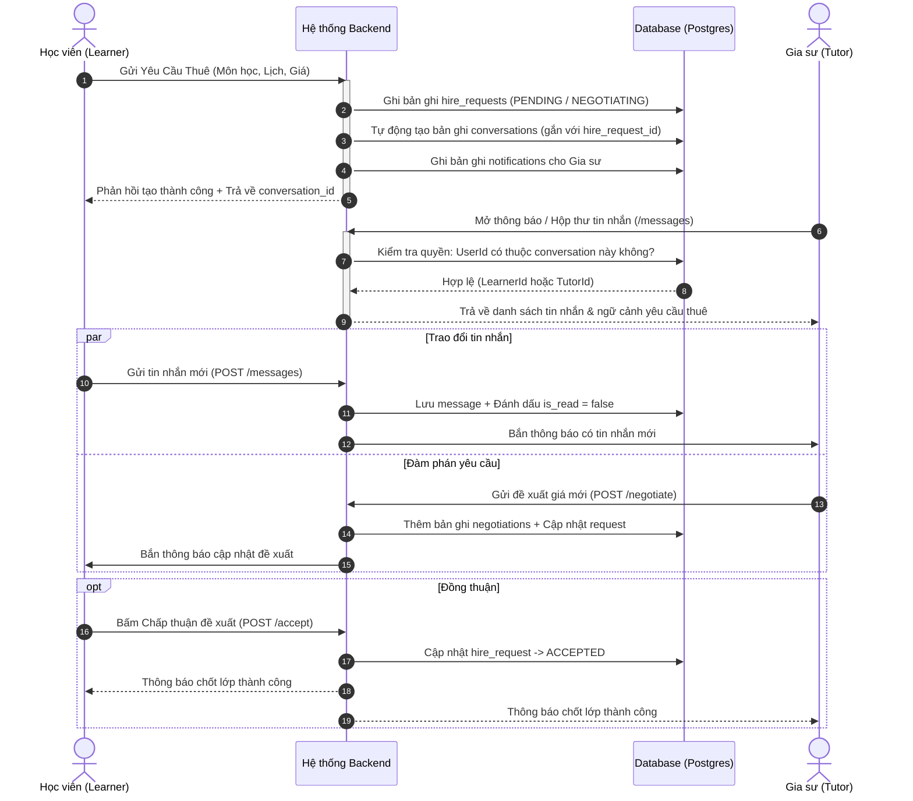

# TutorMatching - Sơ đồ và Luồng Người Dùng Tổng Thể (End-to-End User Flow & Lifecycle Diagrams)

Tài liệu này tổng hợp toàn bộ luồng nghiệp vụ và kiến trúc vận hành của hệ thống **TutorMatching** dựa trên 4 giai đoạn Sprint ([SPRINT-01](sprints/SPRINT-01-FOUNDATION-ACCOUNTS.md), [SPRINT-02](sprints/SPRINT-02-TUTOR-DISCOVERY.md), [SPRINT-03](sprints/SPRINT-03-HIRE-NEGOTIATION.md), [SPRINT-04](sprints/SPRINT-04-MESSAGING-ADMIN-RELEASE.md)), quy chuẩn cơ sở dữ liệu [DatabaseSchema.md](DatabaseSchema.md), và các tài liệu đặc tả kỹ thuật liên quan.

Hệ thống phục vụ 4 nhóm tác nhân chính:
1. **Khách vãng lai (Guest):** Khám phá công khai danh sách gia sư, khóa học, đánh giá.
2. **Học viên (Learner / Parent):** Tìm kiếm gia sư, gửi yêu cầu thuê, thương lượng học phí/lịch học, nhắn tin và theo dõi lớp.
3. **Gia sư (Tutor):** Tạo và hoàn thiện hồ sơ chuyên môn (Onboarding), nộp duyệt, quản lý lịch rảnh/khóa học, đàm phán yêu cầu dạy học và trao đổi với học viên.
4. **Quản trị viên (Admin):** Kiểm duyệt hồ sơ gia sư, quản lý danh mục/nội dung, xử lý vi phạm tài khoản và giám sát toàn bộ hoạt động nền tảng.

---

## 1. Sơ đồ Luồng Tổng Thể Toàn Hệ Thống (Master End-to-End Flow)

```mermaid
flowchart TD
    %% Sprint 1: Guest, Auth & Foundation
    subgraph S1["Sprint 1: Xác Thực & Quản Lý Tài Khoản (Foundation & Accounts)"]
        Guest([Khách vãng lai]) --> Landing["Trang chủ (/) & Tìm kiếm công khai (/tutors)"]
        Landing --> AuthChoice{"Hành động xác thực?"}
        AuthChoice -- "Đăng ký" --> Register["Trang Đăng ký (/register)<br/>Vai trò: LEARNER hoặc TUTOR<br/>6 trường: Role, FullName, Email, Phone, Password, ConfirmPassword"]
        AuthChoice -- "Đăng nhập" --> Login["Trang Đăng nhập (/login)<br/>Xác thực Dual HttpOnly Cookie (JWT 5m + RefreshToken 7d)"]
        Register --> Login
        Login --> RoleCheck{"Phân loại vai trò (Role)?"}
        
        ProfileMgmt["Quản lý hồ sơ cá nhân (/profile)<br/>Cập nhật: FullName, Phone, DOB, AvatarUrl<br/>(Email & Role bất biến)"]
        RoleCheck -.-> ProfileMgmt
    end

    %% Sprint 2: Tutor Onboarding & Admin Approval
    subgraph S2["Sprint 2: Khám Phá & Phê Duyệt Hồ Sơ Gia Sư (Tutor Discovery)"]
        RoleCheck -- "TUTOR" --> TutorStatus{"Trạng thái hồ sơ chuyên môn?"}
        TutorStatus -- "DRAFT / Đang cập nhật" --> OnboardingWizard["Onboarding Wizard (6 bước):<br/>1. Thông tin & Môn nhận dạy<br/>2. Ảnh chân dung & Giới thiệu<br/>3. Bằng cấp & Chứng chỉ<br/>4. Học vấn & Bằng đại học<br/>5. Kinh nghiệm & Phương pháp<br/>6. Thiết lập mức học phí"]
        OnboardingWizard --> SubmitReview["Gửi hồ sơ duyệt (Status: PENDING_REVIEW)"]
        SubmitReview --> WaitingApproval["Trạng thái chờ duyệt<br/>(Bị chặn vào Tutor Dashboard chính)"]
        
        AdminDecision{"Quyết định của Admin?"}
        WaitingApproval -.-> AdminDecision
        AdminDecision -- "Yêu cầu sửa đổi / Từ chối" --> RejectOnboarding["Trạng thái: REJECTED<br/>Kèm lý do/Review Note<br/>Tutor quay lại chỉnh sửa"]
        RejectOnboarding --> OnboardingWizard
        AdminDecision -- "Chấp thuận duyệt" --> ApproveOnboarding["Trạng thái: APPROVED<br/>Tài khoản ACTIVE<br/>Hồ sơ hiển thị trên sàn tìm kiếm"]
        
        ApproveOnboarding --> TutorDashboard["Tutor Workspace (/tutor/dashboard):<br/>- Quản lý lịch rảnh (availability_slots)<br/>- Quản lý khóa học (courses)<br/>- Hồ sơ chuyên môn (/tutor/profile-edit)"]
    end

    %% Sprint 2 & 4: Admin Workspace
    subgraph S4_Admin["Sprint 4 & Sprint 2: Quản Trị Hệ Thống (Admin Operations)"]
        RoleCheck -- "ADMIN" --> AdminDashboard["Admin Dashboard (/admin/dashboard)"]
        AdminDashboard --> ReviewQueue["Hàng đợi duyệt hồ sơ gia sư (/admin/tutor-approvals)"]
        ReviewQueue --> AdminDecision
        AdminDashboard --> UserManagement["Quản lý người dùng: Khóa/Mở khóa tài khoản (/admin/users)"]
        AdminDashboard --> SystemAudit["Nhật ký hệ thống (audit_logs) & Báo cáo số liệu"]
    end

    %% Sprint 3: Discovery & Hire Request Flow
    subgraph S3["Sprint 3: Khám Phá, Thuê & Đàm Phán (Hire & Negotiation)"]
        RoleCheck -- "LEARNER" --> LearnerWorkspace["Learner Workspace (/):<br/>Khóa học hiện tại, Lịch học, Gia sư đã lưu"]
        Landing & LearnerWorkspace --> SearchFilter["Tìm kiếm & Lọc gia sư công khai:<br/>Môn học, Địa điểm, Học phí, Hình thức (Online/Offline), Đánh giá"]
        SearchFilter --> TutorDetail["Xem trang chi tiết Gia sư đã APPROVED<br/>(Ẩn SĐT, Email, Địa chỉ riêng tư)"]
        
        TutorDetail --> ClickHire{"Nhấn 'Thuê gia sư'"}
        ClickHire -- "Chưa đăng nhập" --> Login
        ClickHire -- "Đã đăng nhập LEARNER" --> HireModal["Biểu mẫu Yêu cầu thuê (Hire Request):<br/>- Môn học / Khóa học<br/>- Hình thức dạy & Địa chỉ<br/>- Lịch học (Thứ, Giờ, Thời lượng)<br/>- Đề xuất học phí"]
        
        HireModal --> PriceCheck{"Mức giá đề xuất so với giá niêm yết?"}
        PriceCheck -- "Bằng giá niêm yết" --> CreateReqPending["Khởi tạo: Status = PENDING"]
        PriceCheck -- "Khác giá niêm yết" --> CreateReqNego["Khởi tạo: Status = NEGOTIATING"]
        
        CreateReqPending & CreateReqNego --> AtomicSetup["Hệ thống khởi tạo đồng thời:<br/>1. Bản ghi hire_requests<br/>2. Phòng chat riêng (conversations)<br/>3. Thông báo đẩy cho Gia sư (notifications)"]
        
        AtomicSetup --> TutorInbox["Gia sư nhận thông báo & mở yêu cầu"]
        TutorInbox --> TutorAction{"Hành động của Gia sư?"}
        
        TutorAction -- "Từ chối" --> RejectHire["Trạng thái: REJECTED<br/>(Bắt buộc kèm lý do từ chối)"]
        TutorAction -- "Đồng ý ngay" --> AcceptHire["Trạng thái: ACCEPTED<br/>Khóa lịch và chốt mức giá"]
        TutorAction -- "Đàm phán lại" --> CounterOffer["Đề xuất giá hoặc lịch học mới<br/>(Bản ghi negotiations bất biến)"]
        
        CounterOffer <--> NegotiationLoop{"Thương lượng qua lại giữa Học viên & Gia sư"}
        NegotiationLoop -- "Hai bên đồng thuận" --> AcceptHire
        NegotiationLoop -- "Học viên hủy bỏ" --> CancelHire["Trạng thái: CANCELLED"]
    end

    %% Sprint 4: Request-Scoped Chat & Completion
    subgraph S4_Chat["Sprint 4: Nhắn Tin & Hoàn Tất Lớp Học (Messaging & Completion)"]
        AtomicSetup -.-> ChatChannel["Phòng chat theo yêu cầu (/messages):<br/>- Chỉ 2 bên liên quan được truy cập<br/>- Đánh dấu đã đọc & Thông báo tin nhắn mới"]
        AcceptHire --> ClassActive["Lớp học đi vào hoạt động"]
        ClassActive <--> ChatChannel
        ClassActive --> ClassCompleted["Kết thúc khóa học -> Trạng thái: COMPLETED"]
    end

    %% Styling
    classDef default font-family:sans-serif;
    classDef s1Style fill:#eff6ff,stroke:#3b82f6,stroke-width:1.5px;
    classDef s2Style fill:#fffbeb,stroke:#d97706,stroke-width:1.5px;
    classDef s3Style fill:#f0fdf4,stroke:#16a34a,stroke-width:1.5px;
    classDef s4Style fill:#fdf2f8,stroke:#db2777,stroke-width:1.5px;
    classDef adminStyle fill:#fef2f2,stroke:#dc2626,stroke-width:1.5px;

    class S1,Register,Login,ProfileMgmt s1Style;
    class S2,OnboardingWizard,TutorDashboard,ApproveOnboarding s2Style;
    class S3,SearchFilter,HireModal,AtomicSetup,AcceptHire s3Style;
    class S4_Chat,ChatChannel,ClassActive,ClassCompleted s4Style;
    class S4_Admin,AdminDashboard,ReviewQueue adminStyle;
```

---

## 2. Vòng Đời & Trạng Thái Hồ Sơ Gia Sư (Tutor Profile Lifecycle)

Theo quy định tại **Sprint 2** và bảng `tutor_profiles`:
- Gia sư sau khi đăng ký sẽ có trạng thái mặc định là `DRAFT`.
- Chỉ khi hồ sơ chuyển sang `APPROVED`, gia sư mới được lập chỉ mục (index) và hiển thị trong danh sách tìm kiếm công khai.
- Nếu gia sư thay đổi các thông tin bằng cấp/môn dạy trọng yếu sau khi đã duyệt, hồ sơ phải được nộp duyệt lại.

---

## 3. Máy Trạng Thái Yêu Cầu Thuê & Đàm Phán (Hire Request & Negotiation State Machine)

Theo quy định tại **Sprint 3** và các bảng `hire_requests`, `negotiations`:
- Khi học viên chọn đúng giá niêm yết của gia sư $\rightarrow$ Trạng thái ban đầu là `PENDING`.
- Khi học viên đề xuất mức giá khác $\rightarrow$ Trạng thái ban đầu là `NEGOTIATING`.
- Mỗi lượt trả giá tạo một bản ghi `negotiations` mới có số phiên bản tăng dần ($v_1, v_2, \dots$) để giữ nguyên lịch sử kiểm toán.
- `REJECTED`, `CANCELLED`, `COMPLETED` là các trạng thái kết thúc (Terminal States).

---

## 4. Kiến Trúc Nhắn Tin Gắn Kèm Yêu Cầu Thuê (Request-Scoped Messaging Flow)

Theo quy định tại **Sprint 4** và bảng `conversations`, `messages`:
- Hệ thống áp dụng **Request-Scoped Messaging**: Không mở chat tự do giữa mọi người dùng; mỗi cuộc hội thoại luôn gắn chặt $1-1$ với một `hire_request`.
- Chỉ người gửi yêu cầu (Learner) và người nhận yêu cầu (Tutor) mới có quyền truy cập vào phòng chat đó.

---

## 5. Bảng Ma Trận Hành Trình Người Dùng (User Journey Matrix)

| Giai đoạn | Khách vãng lai (Guest) | Học viên (Learner) | Gia sư (Tutor) | Quản trị viên (Admin) |
| :--- | :--- | :--- | :--- | :--- |
| **1. Khám phá & Đăng ký** | Xem Landing page, tra cứu gia sư, xem chi tiết công khai. | Đăng ký vai trò `LEARNER`, hoàn thiện thông tin cá nhân. | Đăng ký vai trò `TUTOR`, xác nhận email. | Đăng nhập tài khoản nội bộ có vai trò `ADMIN`. |
| **2. Thiết lập hồ sơ** | Không khả dụng. | Cập nhật số điện thoại, ngày sinh, ảnh đại diện tại `/profile`. | Đi qua 6 bước Onboarding, nộp bằng cấp/chứng chỉ, nộp hồ sơ xét duyệt. | Xem danh sách hồ sơ gia sư chờ duyệt tại `/admin/tutor-approvals`. |
| **3. Kiểm duyệt** | Không khả dụng. | Không khả dụng. | Nhận thông báo Kết quả duyệt (Chấp thuận hoặc Từ chối kèm lý do sửa đổi). | Kiểm tra bằng cấp thực tế, phê duyệt (`APPROVED`) hoặc yêu cầu sửa (`REJECTED`). |
| **4. Tìm kiếm & Kết nối** | Thấy gia sư nhưng khi bấm "Thuê" được chuyển đến trang Đăng nhập. | Lọc gia sư theo môn/giá/địa bàn, gửi Yêu cầu thuê kèm lịch học mong muốn. | Mở lịch rảnh (availability), tạo các gói khóa học (courses), chờ nhận yêu cầu. | Giám sát danh mục môn học và khu vực giảng dạy. |
| **5. Thương lượng & Đàm phán** | Không khả dụng. | Nhận đề xuất ngược từ gia sư, đàm phán giá/lịch qua lại, bấm Chấp nhận hoặc Hủy. | Xem chi tiết yêu cầu của học viên, chấp nhận ngay, từ chối, hoặc gửi đề xuất mới. | Xem lịch sử các phiên thương lượng khi có tranh chấp (Dispute). |
| **6. Giao tiếp & Học tập** | Không khả dụng. | Chat trực tiếp với gia sư trong phòng chat gắn với yêu cầu thuê, tham gia học. | Chat trực tiếp với học viên, xác nhận lịch dạy, chuẩn bị tài liệu giảng dạy. | Can thiệp khóa tài khoản nếu có tin nhắn lừa đảo hoặc vi phạm quy chuẩn cộng đồng. |
| **7. Hoàn tất & Đánh giá** | Xem các đánh giá sao công khai của gia sư. | Đánh giá số sao và viết nhận xét sau khi hoàn tất khóa học (`COMPLETED`). | Đóng yêu cầu khi kết thúc khóa học, nhận phản hồi và nâng cao uy tín hồ sơ. | Kiểm duyệt các đánh giá không phù hợp hoặc mang tính công kích cá nhân. |

---

## 6. Đối Chiếu Thực Thể Cơ Sở Dữ Liệu Với Luồng Người Dùng (Data Entity Mapping)

| Luồng chức năng | Các bảng dữ liệu chính ([DatabaseSchema.md](DatabaseSchema.md)) | Vai trò dữ liệu |
| :--- | :--- | :--- |
| **Xác thực & Phiên làm việc** | `accounts`, `token_sessions`, `roles`, `account_roles` | Lưu thông tin định danh, mật khẩu băm, vai trò người dùng và quản lý Dual Cookie / Token phiên. |
| **Hồ sơ cá nhân dùng chung** | `accounts` (các trường `full_name`, `phone_number`, `date_of_birth`, `avatar_url`) | Lưu trữ 4 trường cá nhân cho phép người dùng tự cập nhật qua `PUT /api/v1/users/me`. |
| **Hồ sơ chuyên môn gia sư** | `tutor_profiles`, `tutor_certifications`, `teaching_levels`, `subjects`, `tutor_subjects` | Lưu trạng thái duyệt (`DRAFT`, `PENDING_REVIEW`, `APPROVED`), thông tin học vấn, bằng cấp và môn nhận dạy. |
| **Lịch & Khóa học** | `courses`, `availability_slots` | Quản lý khung giờ rảnh hàng tuần của gia sư và các gói khóa học niêm yết. |
| **Yêu cầu thuê & Đàm phán** | `hire_requests`, `negotiations` | Quản lý vòng đời yêu cầu thuê từ khi gửi, lịch sử các phiên trả giá bất biến, đến khi hoàn tất/hủy bỏ. |
| **Nhắn tin & Trao đổi** | `conversations`, `messages`, `attachments` | Quản lý phòng chat riêng biệt gắn với từng yêu cầu thuê và nội dung tin nhắn giữa hai bên. |
| **Thông báo & Giám sát** | `notifications`, `audit_logs` | Gửi thông báo đẩy về trạng thái yêu cầu, tin nhắn mới và lưu vết kiểm toán cho quản trị viên. |
