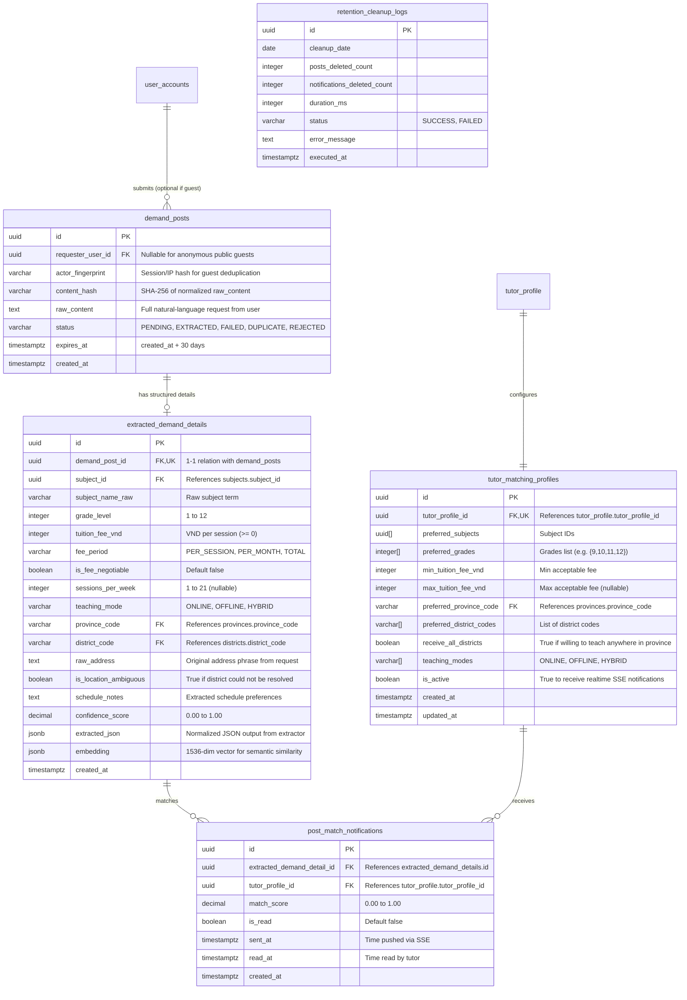

# Phase 1: Data Model Specification (006-crawler-post-matching)

Tài liệu mô tả chi tiết lược đồ cơ sở dữ liệu vật lý (PostgreSQL 17, `snake_case`) cho hệ thống tiếp nhận yêu cầu tìm gia sư bằng ngôn ngữ tự nhiên từ trang Public, lọc trùng qua Redis, bóc tách thực thể, khớp nối gia sư hai chiều (hiển thị Top gia sư + SSE realtime) và tự động dọn dẹp sau 30 ngày.

---

## 1. Entity Relationship Diagram (ERD)



---

## 2. Table Schemas & Constraints (DDL)

### 2.1 Table: `demand_posts`

Lưu trữ yêu cầu tìm gia sư bằng ngôn ngữ tự nhiên do người dùng nhập trên trang Public.

```sql
CREATE TABLE demand_posts (
    id UUID PRIMARY KEY DEFAULT gen_random_uuid(),
    requester_user_id UUID REFERENCES user_accounts(id) ON DELETE SET NULL,
    actor_fingerprint VARCHAR(100) NOT NULL,
    content_hash VARCHAR(64) NOT NULL,
    raw_content TEXT NOT NULL CHECK (char_length(raw_content) BETWEEN 10 AND 2000),
    status VARCHAR(30) NOT NULL DEFAULT 'PENDING'
        CHECK (status IN ('PENDING', 'EXTRACTED', 'FAILED', 'DUPLICATE', 'REJECTED')),
    expires_at TIMESTAMPTZ NOT NULL DEFAULT (CURRENT_TIMESTAMP + INTERVAL '30 days'),
    created_at TIMESTAMPTZ NOT NULL DEFAULT CURRENT_TIMESTAMP
);

-- Index for deduplication lookup by actor + content_hash
CREATE INDEX idx_demand_posts_actor_hash ON demand_posts (actor_fingerprint, content_hash, created_at DESC);

-- Index for 30-day expiration cleanup queries
CREATE INDEX idx_demand_posts_expires_at ON demand_posts (expires_at);
CREATE INDEX idx_demand_posts_created_at ON demand_posts (created_at);

-- Index for status processing queue
CREATE INDEX idx_demand_posts_status ON demand_posts (status, created_at);
```

### 2.2 Table: `extracted_demand_details`

Lưu trữ thông tin thực thể đã bóc tách và chuẩn hóa từ `demand_posts`, phục vụ Matching hai chiều và Semantic Vector Search.

```sql
CREATE TABLE extracted_demand_details (
    id UUID PRIMARY KEY DEFAULT gen_random_uuid(),
    demand_post_id UUID NOT NULL REFERENCES demand_posts(id) ON DELETE CASCADE,
    subject_id UUID REFERENCES subjects(subject_id) ON DELETE SET NULL,
    subject_name_raw VARCHAR(100),
    grade_level INTEGER CHECK (grade_level BETWEEN 1 AND 12),
    tuition_fee_vnd INTEGER NOT NULL DEFAULT 0 CHECK (tuition_fee_vnd >= 0),
    fee_period VARCHAR(20) NOT NULL DEFAULT 'PER_SESSION'
        CHECK (fee_period IN ('PER_SESSION', 'PER_MONTH', 'TOTAL')),
    is_fee_negotiable BOOLEAN NOT NULL DEFAULT FALSE,
    sessions_per_week INTEGER CHECK (sessions_per_week BETWEEN 1 AND 21),
    teaching_mode VARCHAR(20) NOT NULL DEFAULT 'OFFLINE'
        CHECK (teaching_mode IN ('ONLINE', 'OFFLINE', 'HYBRID')),
    province_code VARCHAR(20) REFERENCES provinces(province_code) ON DELETE SET NULL,
    district_code VARCHAR(20) REFERENCES districts(district_code) ON DELETE SET NULL,
    raw_address TEXT,
    is_location_ambiguous BOOLEAN NOT NULL DEFAULT FALSE,
    schedule_notes TEXT,
    confidence_score NUMERIC(3, 2) NOT NULL DEFAULT 0.00
        CHECK (confidence_score BETWEEN 0.00 AND 1.00),
    extracted_json JSONB NOT NULL,
    -- Embedding vector for AI Semantic Search (1536-dim float array in JSONB or pgvector)
    embedding JSONB,
    created_at TIMESTAMPTZ NOT NULL DEFAULT CURRENT_TIMESTAMP
);

CREATE UNIQUE INDEX uq_extracted_demand_details_post_id ON extracted_demand_details (demand_post_id);
CREATE INDEX idx_extracted_demand_details_matching ON extracted_demand_details (subject_id, grade_level, province_code, district_code);
CREATE INDEX idx_extracted_demand_details_ambiguous ON extracted_demand_details (is_location_ambiguous);
```

### 2.3 Table: `tutor_matching_profiles`

Lưu tiêu chí nhận thông báo yêu cầu mới tự động của gia sư.

```sql
CREATE TABLE tutor_matching_profiles (
    id UUID PRIMARY KEY DEFAULT gen_random_uuid(),
    tutor_profile_id UUID NOT NULL REFERENCES tutor_profile(tutor_profile_id) ON DELETE CASCADE,
    preferred_subjects UUID[] NOT NULL DEFAULT '{}',
    preferred_grades INTEGER[] NOT NULL DEFAULT '{}',
    min_tuition_fee_vnd INTEGER NOT NULL DEFAULT 0 CHECK (min_tuition_fee_vnd >= 0),
    max_tuition_fee_vnd INTEGER CHECK (max_tuition_fee_vnd IS NULL OR max_tuition_fee_vnd >= min_tuition_fee_vnd),
    preferred_province_code VARCHAR(20) REFERENCES provinces(province_code) ON DELETE SET NULL,
    preferred_district_codes VARCHAR(20)[] NOT NULL DEFAULT '{}',
    receive_all_districts BOOLEAN NOT NULL DEFAULT FALSE,
    teaching_modes VARCHAR(20)[] NOT NULL DEFAULT '{"OFFLINE", "ONLINE"}',
    is_active BOOLEAN NOT NULL DEFAULT TRUE,
    created_at TIMESTAMPTZ NOT NULL DEFAULT CURRENT_TIMESTAMP,
    updated_at TIMESTAMPTZ NOT NULL DEFAULT CURRENT_TIMESTAMP
);

CREATE UNIQUE INDEX uq_tutor_matching_profiles_tutor ON tutor_matching_profiles (tutor_profile_id);
CREATE INDEX idx_tutor_matching_profiles_active ON tutor_matching_profiles (is_active);
```

### 2.4 Table: `post_match_notifications`

Lưu lịch sử thông báo yêu cầu học mới khớp với từng gia sư (được đẩy qua SSE).

```sql
CREATE TABLE post_match_notifications (
    id UUID PRIMARY KEY DEFAULT gen_random_uuid(),
    extracted_demand_detail_id UUID NOT NULL REFERENCES extracted_demand_details(id) ON DELETE CASCADE,
    tutor_profile_id UUID NOT NULL REFERENCES tutor_profile(tutor_profile_id) ON DELETE CASCADE,
    match_score NUMERIC(3, 2) NOT NULL DEFAULT 1.00 CHECK (match_score BETWEEN 0.00 AND 1.00),
    is_read BOOLEAN NOT NULL DEFAULT FALSE,
    sent_at TIMESTAMPTZ NOT NULL DEFAULT CURRENT_TIMESTAMP,
    read_at TIMESTAMPTZ,
    created_at TIMESTAMPTZ NOT NULL DEFAULT CURRENT_TIMESTAMP
);

CREATE UNIQUE INDEX uq_post_match_notifications_detail_tutor ON post_match_notifications (extracted_demand_detail_id, tutor_profile_id);
CREATE INDEX idx_post_match_notifications_tutor ON post_match_notifications (tutor_profile_id, is_read, created_at DESC);
CREATE INDEX idx_post_match_notifications_created ON post_match_notifications (created_at);
```

### 2.5 Table: `retention_cleanup_logs`

Lưu vết nhật ký thực thi dọn dẹp dữ liệu quá hạn 30 ngày.

```sql
CREATE TABLE retention_cleanup_logs (
    id UUID PRIMARY KEY DEFAULT gen_random_uuid(),
    cleanup_date DATE NOT NULL,
    posts_deleted_count INTEGER NOT NULL DEFAULT 0,
    notifications_deleted_count INTEGER NOT NULL DEFAULT 0,
    duration_ms INTEGER NOT NULL DEFAULT 0,
    status VARCHAR(20) NOT NULL CHECK (status IN ('SUCCESS', 'FAILED')),
    error_message TEXT,
    executed_at TIMESTAMPTZ NOT NULL DEFAULT CURRENT_TIMESTAMP
);
```
