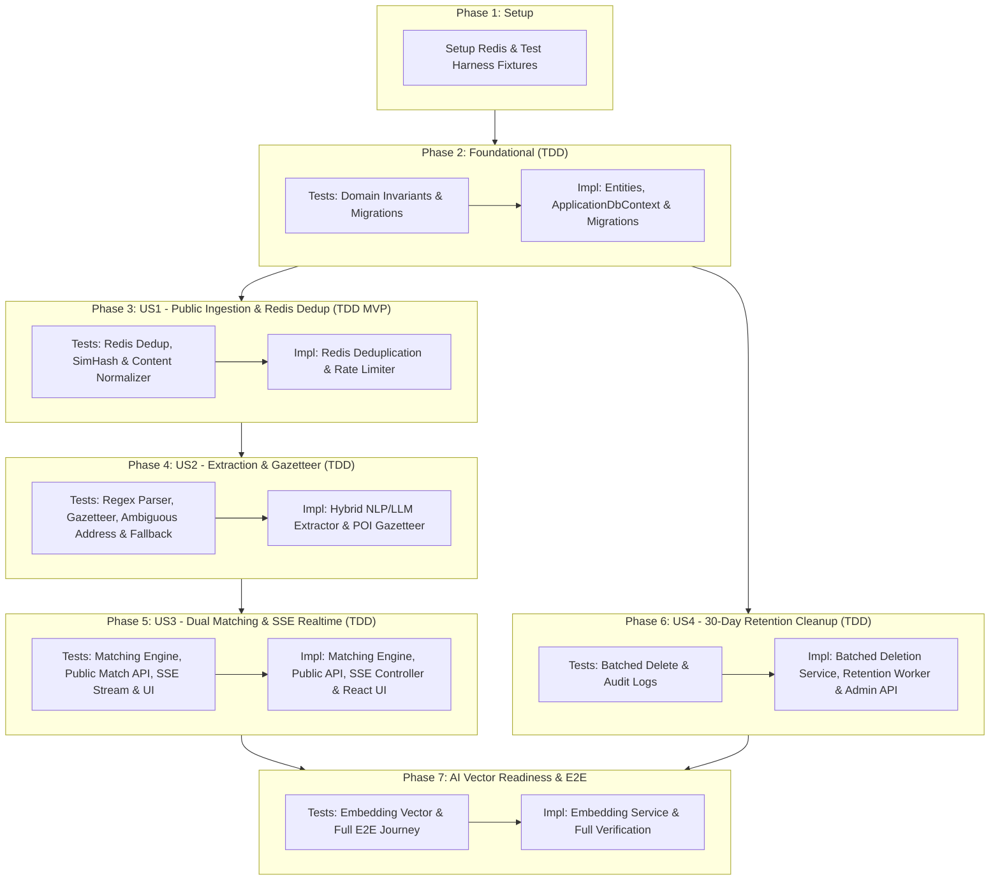

# Tasks: Public Natural-Language Tutor Demand Matching, Redis Deduplication, Entity Extraction, Realtime SSE Delivery & 30-Day Retention (TDD Approach)

**Input**: Design documents from `/specs/006-crawler-post-matching/` (`spec.md`, `plan.md`, `data-model.md`, `contracts/sse-matched-posts.yaml`, `research.md`, `quickstart.md`)
**TDD Methodology**: Red-Green-Refactor cycle. All unit, contract, and integration tests MUST be written first and observed to fail before writing production implementation.

## Format: `- [ ] [TaskID] [P?] [Story?] Description with file path`

- **[P]**: Can run in parallel (different files, no dependencies)
- **[Story]**: Which user story this task belongs to (`[US1]`, `[US2]`, `[US3]`, `[US4]`)
- Every task specifies the exact repository-relative path aligned with existing codebase conventions (`ApplicationDbContext`, module-based folders).

---

## Phase 1: Setup & Test Harness Infrastructure

**Goal**: Bổ sung Redis vào Docker Compose, cài đặt package `StackExchange.Redis` & `Testcontainers.Redis`, và chuẩn bị test fixtures cho xUnit & Vitest.

- [x] T001 Thêm dịch vụ Redis (`redis:7.2-alpine`) vào Docker Compose tại `backend/compose.yaml`
- [x] T002 Cấu hình biến môi trường kết nối Redis (`REDIS_CONNECTION_STRING`) trong `backend/.env.example` và `backend/src/TutorMatching.Infrastructure/Configurations/DotEnvLoader.cs`
- [x] T003 [P] Cài đặt package `StackExchange.Redis` vào `backend/src/TutorMatching.Infrastructure/TutorMatching.Infrastructure.csproj`
- [x] T004 [P] Cài đặt `Testcontainers.Redis` vào test project `backend/tests/TutorMatching.Api.IntegrationTests/TutorMatching.Api.IntegrationTests.csproj`
- [x] T005 [P] Xây dựng test fixture `RedisTestFixture.cs` khởi tạo Redis Testcontainer dùng chung tại `backend/tests/TutorMatching.Api.IntegrationTests/Fixtures/RedisTestFixture.cs`
- [x] T006 Đăng ký `IConnectionMultiplexer` singleton và Redis Health Check trong `backend/src/TutorMatching.Infrastructure/DependencyInjection.cs`

---

## Phase 2: Foundational (Entities, Invariants & Migrations)

**Goal**: Định nghĩa các thực thể Domain (`DemandPost`, `ExtractedDemandDetail`, `TutorMatchingProfile`, `PostMatchNotification`, `RetentionCleanupLog`), ràng buộc bất biến (Invariants) và migration database bằng TDD.

### Tests for Foundational Phase (TDD - Write First & Verify Failure) ⚠️

- [x] T007 [P] Viết Unit Tests kiểm tra bất biến Domain của `DemandPost` (`raw_content` 10–2000 ký tự, `actor_fingerprint` & `content_hash` bắt buộc, default status `PENDING`, `expires_at = created_at + 30 days`) tại `backend/tests/TutorMatching.Domain.UnitTests/Content/DemandPostTests.cs`
- [x] T008 [P] Viết Unit Tests kiểm tra bất biến Domain của `ExtractedDemandDetail` (`grade_level` 1–12, `tuition_fee_vnd >= 0`, `sessions_per_week` 1–21, `confidence_score` 0.0–1.0, `is_location_ambiguous = true` khi `district_code` null) tại `backend/tests/TutorMatching.Domain.UnitTests/Content/ExtractedDemandDetailTests.cs`
- [x] T009 [P] Viết Unit Tests kiểm tra bất biến Domain của `TutorMatchingProfile` (`min_tuition_fee_vnd >= 0`, `max_tuition_fee_vnd >= min_tuition_fee_vnd`, `preferred_grades` trong khoảng 1–12) tại `backend/tests/TutorMatching.Domain.UnitTests/Tutors/TutorMatchingProfileTests.cs`
- [x] T010 [P] Viết Integration Tests kiểm tra tính toàn vẹn Migration Database và các ràng buộc Unique/Foreign Key (`uq_extracted_demand_details_post_id`, `ON DELETE CASCADE` từ `demand_posts` sang `extracted_demand_details` và `post_match_notifications`) tại `backend/tests/TutorMatching.Api.IntegrationTests/Persistence/DemandMatchingMigrationTests.cs`

### Implementation for Foundational Phase (Make Tests Pass)

- [x] T011 [P] Triển khai Entity `DemandPost` và Enum `PostStatus` (`PENDING`, `EXTRACTED`, `FAILED`, `DUPLICATE`, `REJECTED`) tại `backend/src/TutorMatching.Domain/Content/DemandPost.cs`
- [x] T012 [P] Triển khai Entity `ExtractedDemandDetail` với các trường nghiệp vụ chuẩn hóa và cột vector `embedding` tại `backend/src/TutorMatching.Domain/Content/ExtractedDemandDetail.cs`
- [x] T013 [P] Triển khai Entity `TutorMatchingProfile` tại `backend/src/TutorMatching.Domain/Tutors/TutorMatchingProfile.cs`
- [x] T014 [P] Triển khai Entity `PostMatchNotification` tại `backend/src/TutorMatching.Domain/Notifications/PostMatchNotification.cs`
- [x] T015 [P] Triển khai Entity `RetentionCleanupLog` tại `backend/src/TutorMatching.Domain/Content/RetentionCleanupLog.cs`
- [x] T016 Triển khai EF Core Entity Configurations với quy ước `snake_case`, check constraints và indexes tại `backend/src/TutorMatching.Infrastructure/Persistence/Configurations/DemandMatchingEntitiesConfiguration.cs`
- [x] T017 Đăng ký các DbSet mới (`DemandPosts`, `ExtractedDemandDetails`, `TutorMatchingProfiles`, `PostMatchNotifications`, `RetentionCleanupLogs`) vào `ApplicationDbContext` tại `backend/src/TutorMatching.Infrastructure/Persistence/ApplicationDbContext.cs`
- [x] T018 Tạo và chạy EF Core Migration `AddDemandMatchingAndRetentionTables` qua `backend/tools/TutorMatching.DatabaseMigrator`

**Checkpoint**: Chạy `dotnet test backend/tests/TutorMatching.Domain.UnitTests` và `DemandMatchingMigrationTests` $\rightarrow$ TẤT CẢ GREEN.

---

## Phase 3: User Story 1 - Tiếp nhận yêu cầu từ trang Public và lọc trùng qua Redis (Priority: P1) 🎯 MVP

**Goal**: Tiếp nhận câu yêu cầu tìm gia sư tự nhiên từ trang Public, kiểm tra lọc trùng tức thì ($< 10\text{ms}$) qua Redis Content-Hash & SimHash, chống spam/rate-limit và lưu vào `demand_posts`.

### Tests for User Story 1 (TDD - Write First & Verify Failure) ⚠️

- [x] T019 [P] [US1] Viết Unit Tests cho `RedisDeduplicationService` kiểm tra lệnh SetNX theo `actor_fingerprint + content_hash` (lần 1 trả về mới, lần 2 trùng lặp trả về `demandPostId` đã cache trong $< 10\text{ms}$) và SimHash phát hiện nội dung gần trùng trong 48h tại `backend/tests/TutorMatching.Application.UnitTests/Storage/RedisDeduplicationServiceTests.cs`
- [x] T020 [P] [US1] Viết Unit Tests cho `ContentHashNormalizer` kiểm tra chuẩn hóa chuỗi tiếng Việt (trim, lowercase, loại bỏ khoảng trắng thừa/ký tự rác) và tính SHA-256 + SimHash tại `backend/tests/TutorMatching.Application.UnitTests/Extraction/ContentHashNormalizerTests.cs`
- [x] T021 [P] [US1] Viết Integration Tests cho luồng tiếp nhận yêu cầu từ trang Public: Gửi 10 yêu cầu (trong đó có 3 yêu cầu bấm đúp trùng hệt và 2 yêu cầu sửa nhẹ dấu câu), kiểm tra chỉ các yêu cầu duy nhất tạo bản ghi `EXTRACTED` mới và yêu cầu trùng nhận phản hồi `isDeduplicatedHit = true` tại `backend/tests/TutorMatching.Api.IntegrationTests/Demands/PublicDemandIngestionTests.cs`

### Implementation for User Story 1 (Make Tests Pass)

- [x] T022 [US1] Định nghĩa Port `IRedisDeduplicationService` tại `backend/src/TutorMatching.Application/Abstractions/IRedisDeduplicationService.cs`
- [x] T023 [P] [US1] Triển khai `ContentHashNormalizer` tính SHA-256 và SimHash cho văn bản yêu cầu tại `backend/src/TutorMatching.Application/Tutors/ContentHashNormalizer.cs`
- [x] T024 [P] [US1] Triển khai `RedisDeduplicationService` sử dụng Redis SetNX (`demand:seen:{actor}:{hash}`), SimHash và Sliding-Window Rate Limit tại `backend/src/TutorMatching.Infrastructure/Storage/RedisDeduplicationService.cs`

**Checkpoint**: Chạy T019 - T021 $\rightarrow$ TẤT CẢ GREEN.

---

## Phase 4: User Story 2 - Bóc tách thực thể và chuẩn hóa dữ liệu từ yêu cầu tự nhiên (Extraction Service) (Priority: P2)

**Goal**: Chuyển đổi văn bản tự nhiên của người dùng thành JSON có cấu trúc (môn, lớp, học phí, hình thức, tỉnh/quận), giải quyết rủi ro địa chỉ không rõ Quận/Huyện bằng từ điển Landmark Gazetteer và tự động fallback nếu LLM chậm/lỗi.

### Tests for User Story 2 (TDD - Write First & Verify Failure) ⚠️

- [x] T025 [P] [US2] Viết Unit Tests cho `RegexEntityExtractor` kiểm tra trích xuất Môn học, Khối lớp (1–12, "ôn thi vào 10" $\rightarrow$ 9, "ôn thi ĐH" $\rightarrow$ 12), Số buổi/tuần và Mức học phí ("250k/b", "1tr6/8b", "thỏa thuận" $\rightarrow$ VND/buổi) tại `backend/tests/TutorMatching.Application.UnitTests/Extraction/RegexEntityExtractorTests.cs`
- [x] T026 [P] [US2] Viết Unit Tests cho `VietnamLandmarkGazetteer` kiểm tra ánh xạ địa danh POI quen thuộc ("ĐH Bách Khoa" $\rightarrow$ Hai Bà Trưng, "Keangnam" $\rightarrow$ Nam Từ Liêm, "Ciputra" $\rightarrow$ Tây Hồ, "ĐHQG" $\rightarrow$ Cầu Giấy) tại `backend/tests/TutorMatching.Application.UnitTests/Extraction/VietnamLandmarkGazetteerTests.cs`
- [x] T027 [P] [US2] Viết Unit Tests cho `AddressResolutionService` kiểm tra 3 tầng xử lý: Gazetteer $\rightarrow$ Fuzzy Matching bảng `districts` $\rightarrow$ Fallback gán `district_code = null` và `is_location_ambiguous = true` tại `backend/tests/TutorMatching.Application.UnitTests/Extraction/AddressResolutionServiceTests.cs`
- [x] T028 [P] [US2] Viết Unit Tests cho `HybridExtractionService` kiểm tra kết hợp LLM + Regex/Gazetteer, Circuit Breaker tự động fallback về Regex/Gazetteer khi LLM timeout ($> 2.5\text{s}$), và từ chối văn bản rác (`confidence_score < 0.40` $\rightarrow$ `REJECTED`) tại `backend/tests/TutorMatching.Application.UnitTests/Extraction/HybridExtractionServiceTests.cs`

### Implementation for User Story 2 (Make Tests Pass)

- [x] T029 [US2] Định nghĩa Port `IExtractionService` và DTO `ExtractedDemandCriteriaDto` tại `backend/src/TutorMatching.Application/Abstractions/IExtractionService.cs`
- [x] T030 [P] [US2] Triển khai từ điển địa danh `VietnamLandmarkGazetteer` tại `backend/src/TutorMatching.Infrastructure/Extraction/VietnamLandmarkGazetteer.cs`
- [x] T031 [P] [US2] Triển khai `RegexEntityExtractor` cho Môn học, Khối lớp, Học phí, Hình thức học và Số buổi/tuần tại `backend/src/TutorMatching.Infrastructure/Extraction/RegexEntityExtractor.cs`
- [x] T032 [US2] Triển khai `AddressResolutionService` kết hợp Gazetteer, Fuzzy Matching và cờ `is_location_ambiguous` tại `backend/src/TutorMatching.Infrastructure/Extraction/AddressResolutionService.cs`
- [x] T033 [US2] Triển khai `LlmEntityExtractor` và `HybridExtractionService` (kèm Circuit Breaker timeout $2.5\text{s}$) tại `backend/src/TutorMatching.Infrastructure/Extraction/HybridExtractionService.cs`

**Checkpoint**: Chạy T025 - T028 $\rightarrow$ TẤT CẢ GREEN.

---

## Phase 5: User Story 3 - Khớp nối Gia sư trên trang Public & Thông báo SSE Thời gian thực (Priority: P3)

**Goal**:

1. Trên trang Public: Trả về ngay danh sách **Top Gia sư phù hợp nhất** (`APPROVED` + `ACTIVE`, bảo mật thông tin riêng tư theo SRS) cùng các thẻ tiêu chí đã bóc tách.
2. Cho Gia sư: Đẩy thông báo tức thì qua **Server-Sent Events (SSE)** (`GET /api/v1/tutors/me/matched-posts/stream`) tới Dashboard của các gia sư khớp tiêu chí trong vòng $< 2$ giây.

### Tests for User Story 3 (TDD - Write First & Verify Failure) ⚠️

- [x] T034 [P] [US3] Viết Unit Tests cho `MatchingEngine`: Kiểm tra chấm điểm tương thích hai chiều (1: Tìm `TutorProfile` `APPROVED` + `ACTIVE` cho người dùng Public, loại bỏ gia sư `PENDING`/`LOCKED`; 2: Khớp `TutorMatchingProfile` theo môn, lớp, học phí, quận/huyện, `ONLINE` và `receive_all_districts`) tại `backend/tests/TutorMatching.Application.UnitTests/Matching/MatchingEngineTests.cs`
- [x] T035 [P] [US3] Viết Integration & Contract Tests cho `POST /api/v1/public/tutor-demands/match`: Kiểm tra trả về `extractedCriteria` + `matchedTutors` đúng OpenAPI schema, không rò rỉ email/SĐT/ngày sinh/địa chỉ chi tiết của gia sư, và lưu `demand_posts` + `extracted_demand_details` tại `backend/tests/TutorMatching.Api.IntegrationTests/Demands/PublicTutorDemandMatchApiTests.cs`
- [x] T036 [P] [US3] Viết Integration Tests cho SSE Stream `GET /api/v1/tutors/me/matched-posts/stream`: Kiểm tra bắt buộc JWT role `TUTOR` (`APPROVED`), format `text/event-stream`, sự kiện `post_matched` được đẩy trong $< 2\text{s}$ khi người dùng gửi yêu cầu mới trên trang Public, và hỗ trợ phát bù qua `Last-Event-ID` tại `backend/tests/TutorMatching.Api.IntegrationTests/Matching/TutorMatchedPostsSseTests.cs`
- [x] T037 [P] [US3] Viết Contract Tests cho API cấu hình tiêu chí `GET & PUT /api/v1/tutors/me/matching-profile` và lịch sử `GET /api/v1/tutors/me/matched-posts` tại `backend/tests/TutorMatching.Api.IntegrationTests/Matching/TutorMatchingProfileApiTests.cs`
- [x] T038 [P] [US3] Viết Frontend Component Tests cho `PublicSmartDemandSearch.tsx` (ô nhập yêu cầu tự nhiên ở trang Public, hiển thị thẻ tiêu chí đã bóc tách, cảnh báo địa chỉ mơ hồ và danh sách gia sư phù hợp) tại `frontend/tests/components/PublicSmartDemandSearch.test.tsx`
- [x] T039 [P] [US3] Viết Frontend Hook Tests cho `usePostMatchStream.ts` (mô phỏng `EventSource`, xử lý reconnect exponential backoff, cập nhật state feed) và Component Tests cho `TutorLiveMatchedPostsFeed.tsx` tại `frontend/tests/hooks/usePostMatchStream.test.ts` và `frontend/tests/components/TutorLiveMatchedPostsFeed.test.tsx`

### Implementation for User Story 3 (Make Tests Pass)

- [x] T040 [US3] Định nghĩa Port `IMatchingEngine` và `ISseNotificationPublisher` tại `backend/src/TutorMatching.Application/Abstractions/IMatchingEngine.cs` và `backend/src/TutorMatching.Application/Abstractions/ISseNotificationPublisher.cs`
- [x] T041 [P] [US3] Triển khai `MatchingEngine` và `SubmitPublicTutorDemandHandler` tại `backend/src/TutorMatching.Application/Tutors/MatchingEngine.cs` và `backend/src/TutorMatching.Application/Tutors/SubmitPublicTutorDemandHandler.cs`
- [x] T042 [P] [US3] Triển khai `RedisSseNotificationPublisher` qua Redis Pub/Sub kèm buffer replay cho `Last-Event-ID` tại `backend/src/TutorMatching.Infrastructure/Storage/RedisSseNotificationPublisher.cs`
- [x] T043 [US3] Triển khai Controller `PublicTutorDemandsController.cs` (`POST /api/v1/public/tutor-demands/match`) tại `backend/src/TutorMatching.Api/Controllers/PublicTutorDemandsController.cs`
- [x] T044 [US3] Triển khai SSE Controller `TutorMatchedPostsSseController.cs` (`GET /api/v1/tutors/me/matched-posts/stream`) và `TutorMatchingProfileController.cs` (`GET & PUT /api/v1/tutors/me/matching-profile`, `GET /api/v1/tutors/me/matched-posts`) tại `backend/src/TutorMatching.Api/Controllers/TutorMatchedPostsSseController.cs` và `backend/src/TutorMatching.Api/Controllers/TutorMatchingProfileController.cs`
- [x] T045 [P] [US3] Triển khai API client và component `PublicSmartDemandSearch.tsx` tích hợp vào trang khám phá gia sư công khai tại `frontend/src/lib/api/tutor-demands.ts` và `frontend/src/components/tutors/PublicSmartDemandSearch.tsx`
- [x] T046 [P] [US3] Triển khai React Custom Hook `usePostMatchStream.ts` và UI Component `TutorLiveMatchedPostsFeed.tsx` nhúng vào Tutor Dashboard tại `frontend/src/hooks/usePostMatchStream.ts`, `frontend/src/components/tutor/TutorLiveMatchedPostsFeed.tsx` và `frontend/src/app/(tutor)/tutor/page.tsx`

**Checkpoint**: Chạy T034 - T039 $\rightarrow$ TẤT CẢ GREEN. Người dùng trên trang Public nhận ngay danh sách gia sư phù hợp và gia sư nhận thông báo SSE realtime.

---

## Phase 6: User Story 4 - Tự động dọn dẹp và thu hồi dữ liệu quá hạn (30-Day Data Retention) (Priority: P4)

**Goal**: Tự động dọn dẹp dữ liệu yêu cầu tìm gia sư (`demand_posts`), thông tin bóc tách (`extracted_demand_details`) và thông báo (`post_match_notifications`) cũ hơn 30 ngày theo từng lô (batch 1.000 dòng) vào 02:00 AM hàng ngày, ghi nhận audit log đầy đủ.

### Tests for User Story 4 (TDD - Write First & Verify Failure) ⚠️

- [ ] T047 [P] [US4] Viết Unit Tests cho `PostgreSqlDataRetentionService`: Xác minh chỉ các bản ghi có `created_at < NOW() - INTERVAL '30 days'` bị xóa, bản ghi mới không bị xóa, và batch size không vượt quá 1.000 dòng tại `backend/tests/TutorMatching.Application.UnitTests/Retention/DataRetentionServiceTests.cs`
- [ ] T048 [P] [US4] Viết Integration Tests cho `RetentionCleanupWorker`: Chèn 100 bản ghi 35 ngày trước và 50 bản ghi 10 ngày trước, kích hoạt worker, xác minh xóa chính xác 100 bản ghi cũ, giữ nguyên 50 bản ghi mới, kiểm tra cascade xóa sạch `extracted_demand_details` và `post_match_notifications`, ghi nhận log thành công vào `retention_cleanup_logs` tại `backend/tests/TutorMatching.Api.IntegrationTests/Retention/RetentionCleanupIntegrationTests.cs`
- [ ] T049 [P] [US4] Viết Contract Tests cho API Admin kích hoạt dọn dẹp thủ công `POST /api/v1/admin/demands/cleanup-expired` (kiểm tra phân quyền `ADMIN` và cấu trúc `RetentionCleanupResultDto`) tại `backend/tests/TutorMatching.Api.IntegrationTests/Retention/AdminRetentionApiTests.cs`

### Implementation for User Story 4 (Make Tests Pass)

- [ ] T050 [US4] Định nghĩa Port `IDataRetentionService` tại `backend/src/TutorMatching.Application/Abstractions/IDataRetentionService.cs`
- [ ] T051 [US4] Triển khai `PostgreSqlDataRetentionService` (xóa phân lô 1.000 dòng kết hợp pause 100ms và ghi bảng `retention_cleanup_logs`) tại `backend/src/TutorMatching.Infrastructure/Retention/PostgreSqlDataRetentionService.cs`
- [ ] T052 [US4] Triển khai `RetentionCleanupWorker` (`BackgroundService` chạy định kỳ 02:00 AM UTC+7) tại `backend/src/TutorMatching.Infrastructure/Retention/RetentionCleanupWorker.cs`
- [ ] T053 [US4] Expose API Admin `POST /api/v1/admin/demands/cleanup-expired` tại `backend/src/TutorMatching.Api/Controllers/AdminDemandsController.cs`

**Checkpoint**: Chạy T047 - T049 $\rightarrow$ TẤT CẢ GREEN. Dữ liệu quá hạn 30 ngày được dọn dẹp tự động và an toàn.

---

## Phase 7: Polish, Cross-Cutting & AI Vector Search Readiness

**Goal**: Đảm bảo cột vector `embedding` và interface `ITextEmbeddingService` hoạt động đồng bộ cho xếp hạng tương đồng ngữ nghĩa, và kiểm thử E2E toàn trình.

### Tests for AI Readiness & Verification (TDD) ⚠️

- [ ] T054 [P] Viết Unit Tests cho `ITextEmbeddingService` và `DeterministicTextEmbeddingService` kiểm tra sinh vector 1536 chiều chuẩn hóa và tính điểm Cosine Similarity tại `backend/tests/TutorMatching.Application.UnitTests/Ai/TextEmbeddingServiceTests.cs`
- [ ] T055 [P] Viết Integration Tests kiểm tra lưu trữ và truy vấn tương đồng vector trên cột `embedding` của bảng `extracted_demand_details` tại `backend/tests/TutorMatching.Api.IntegrationTests/Ai/VectorEmbeddingPersistenceTests.cs`
- [ ] T056 Viết E2E Test kịch bản luồng hoàn chỉnh: Người dùng nhập yêu cầu ở trang Public $\rightarrow$ Bóc tách & Hiển thị danh sách gia sư phù hợp $\rightarrow$ Gia sư nhận thông báo SSE realtime trên Dashboard tại `frontend/tests/e2e/public-demand-matching-stream.spec.ts`

### Implementation for Polish & AI Readiness

- [ ] T057 [P] Định nghĩa Port `ITextEmbeddingService` tại `backend/src/TutorMatching.Application/Abstractions/ITextEmbeddingService.cs`
- [ ] T058 [P] Triển khai `DeterministicTextEmbeddingService` ghi vector vào cột `embedding` tại `backend/src/TutorMatching.Infrastructure/Extraction/DeterministicTextEmbeddingService.cs`
- [ ] T059 Đo kiểm độ trễ toàn trình: phản hồi trang Public ($< 2.5\text{s}$), đẩy SSE ($< 2\text{s}$) và lọc trùng Redis ($< 10\text{ms}$)
- [ ] T060 Chạy toàn bộ test suite `dotnet test backend/TutorMatching.slnx` và `npm --prefix frontend run test`

---

## Dependencies & TDD Execution Order

### Summary of TDD Tasks Breakdown:

- **Total Task Count**: 60 tasks
- **Test Tasks (Red Phase)**: 24 test tasks (Unit, Integration, Contract, Frontend Component/Hook, E2E)
- **Implementation Tasks (Green & Refactor Phase)**: 36 tasks
- **MVP Scope**: Hoàn thành Phase 1 $\rightarrow$ Phase 4 để kiểm chứng đầu vào yêu cầu tự nhiên từ trang Public, lọc trùng qua Redis và bóc tách JSON chuẩn xác; tiếp nối Phase 5 để hiển thị danh sách gia sư ngay trên trang Public và bắn SSE cho gia sư.
