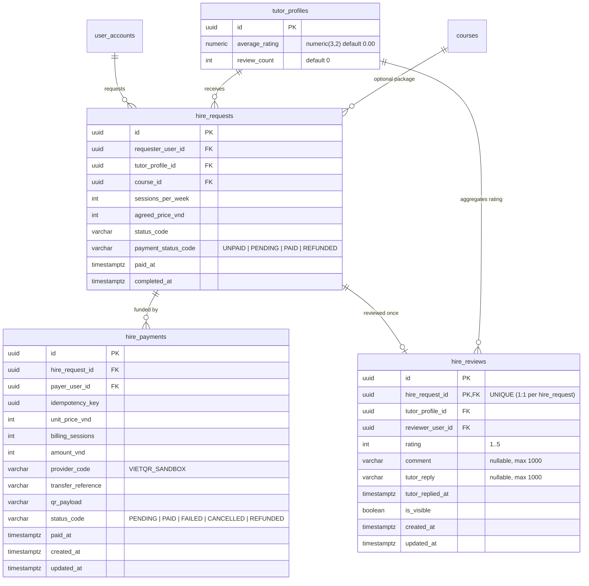

# Data Model: Hire Request Payment & Post-Lesson Tutor Reviews

**Feature**: `009-hire-payment-and-reviews` | **Date**: 2026-11-08

---

## 1. Entity Relationship Diagram

---

## 2. Physical Constraints & Indexes (`snake_case`)

### `hire_requests` (Additive Columns)

- `payment_status_code varchar(24) NOT NULL DEFAULT 'UNPAID'`
  - Check constraint `ck_hire_requests_payment_status_code`: `payment_status_code IN ('UNPAID', 'PENDING', 'PAID', 'REFUNDED')`
- `paid_at timestamptz NULL`

### `hire_payments` (New Table)

- Primary Key: `pk_hire_payments (id)`
- Foreign Keys:
  - `fk_hire_payments_hire_requests_hire_request_id` → `hire_requests(id)` (`ON DELETE CASCADE`)
  - `fk_hire_payments_user_accounts_payer_user_id` → `user_accounts(id)` (`ON DELETE RESTRICT`)
- Unique Constraints:
  - `ix_hire_payments_payer_user_id_idempotency_key` UNIQUE `(payer_user_id, idempotency_key)`
- Indexes:
  - `ix_hire_payments_hire_request_id_created_at` `(hire_request_id, created_at DESC)`
- Check Constraints:
  - `ck_hire_payments_positive_amounts`: `unit_price_vnd > 0 AND billing_sessions > 0 AND amount_vnd = unit_price_vnd * billing_sessions`
  - `ck_hire_payments_status_code`: `status_code IN ('PENDING', 'PAID', 'FAILED', 'CANCELLED', 'REFUNDED')`

### `hire_reviews` (New Table)

- Primary Key: `pk_hire_reviews (id)`
- Unique Constraints:
  - `ix_hire_reviews_hire_request_id` UNIQUE `(hire_request_id)`
- Indexes:
  - `ix_hire_reviews_tutor_profile_id_is_visible_created_at` `(tutor_profile_id, is_visible, created_at DESC)`
- Check Constraints:
  - `ck_hire_reviews_rating`: `rating >= 1 AND rating <= 5`

### `tutor_profiles` (Additive Columns)

- `average_rating numeric(3,2) NOT NULL DEFAULT 0.00`
- `review_count integer NOT NULL DEFAULT 0`
